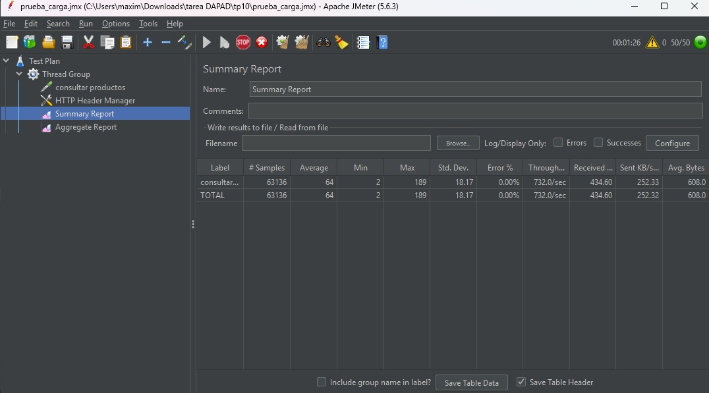
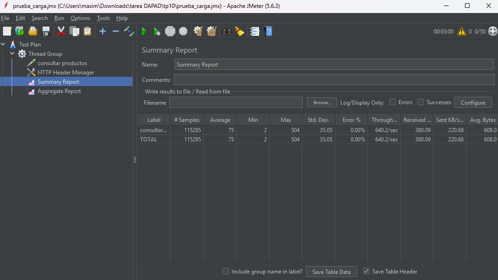
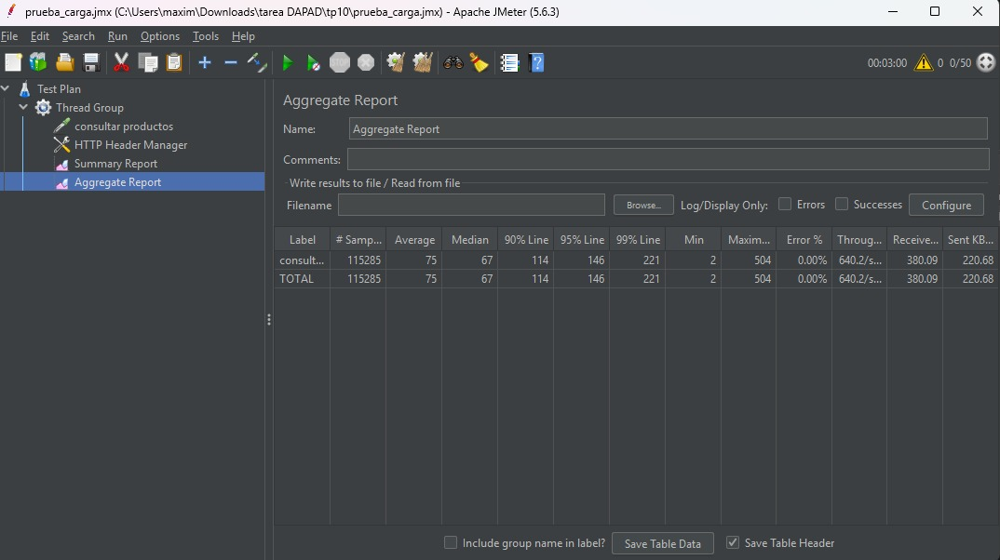
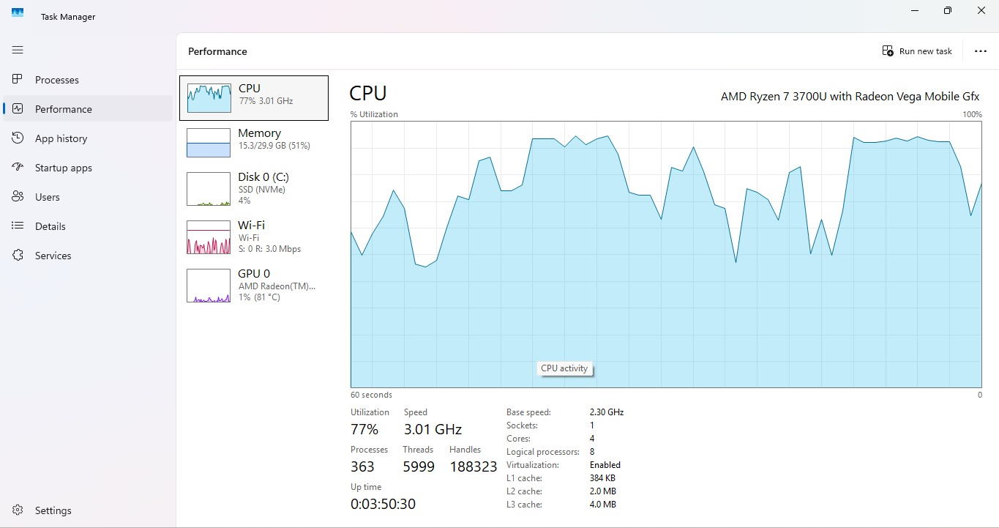
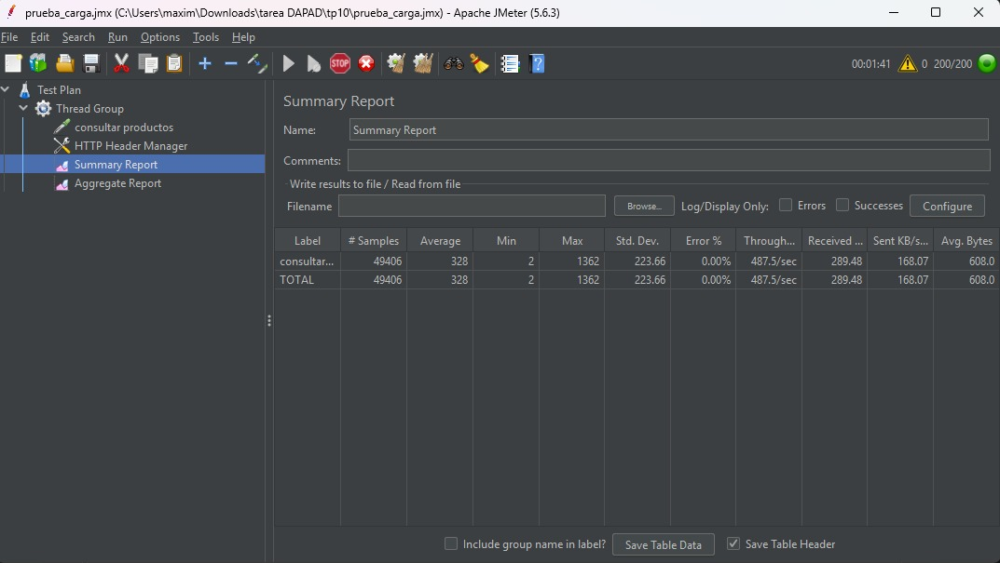
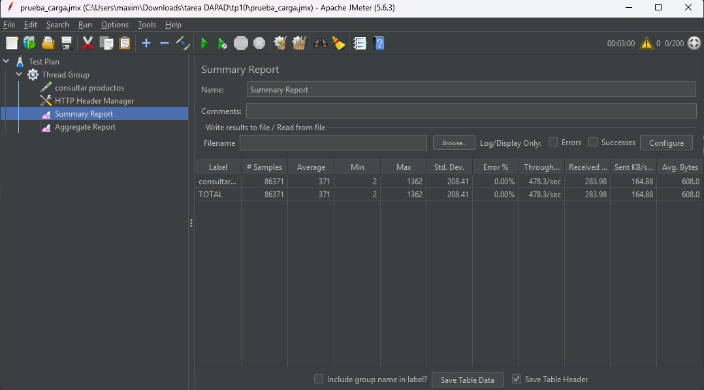
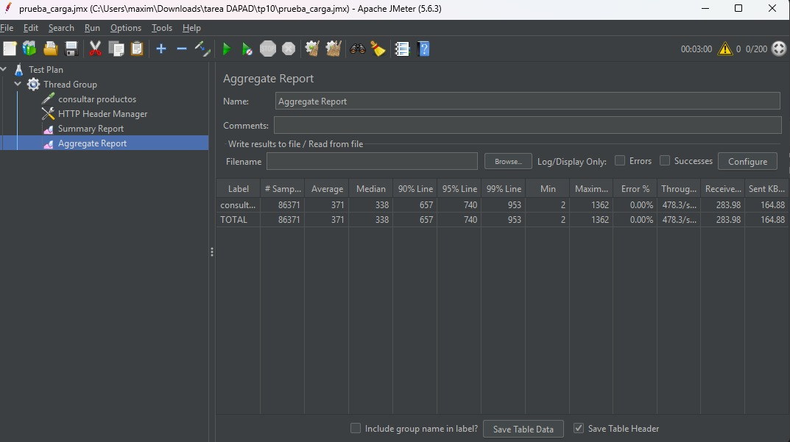
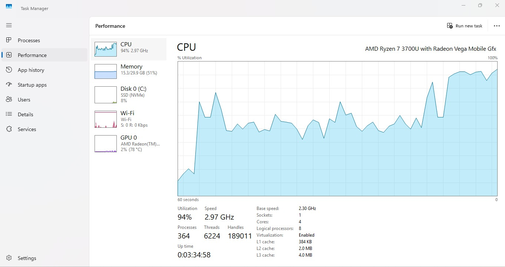

### TP10 — Monitoreo, Pruebas de Carga y Evaluación de Desempeño

Materia: Desarrollo de Aplicaciones para Ambientes Distribuidos
Unidad: 4 — Evaluación del desempeño, Monitoreo y Optimización
Estudiante: Maximiliano nahuel Martínez

---

1. Objetivo

Evaluar el comportamiento y rendimiento de un servicio REST mediante pruebas de carga y estrés, utilizando Apache JMeter para generar solicitudes concurrentes.

Se busca analizar los tiempos de respuesta, el throughput, la tasa de errores y el consumo de recursos del sistema, identificando posibles cuellos de botella.

2. Servicio evaluado

Se utilizó el backend desarrollado en el TP9, implementado con Node.js y Express.

- Protocolo: HTTPS.
- Puerto: 3000.
- Endpoint: "GET /productos".
- Base de datos: PostgreSQL.
- Herramienta de pruebas: Apache JMeter 5.6.3.

El servicio fue ejecutado localmente en un entorno controlado.

3. Entorno de ejecución

Componente| Características
Procesador| AMD Ryzen 7 3700U
Núcleos| 4
Procesadores lógicos| 8
Memoria RAM| 29,9 GB detectados
Sistema operativo| Windows
Herramienta| Apache JMeter 5.6.3

4. Configuración de las pruebas

Se realizaron dos escenarios de evaluación.

4.1 Prueba de carga normal

- Usuarios concurrentes: 50.
- Ramp-up: 10 segundos.
- Duración: 180 segundos (3 minutos).
- Solicitud: GET /productos.

4.2 Prueba de estrés

- Usuarios concurrentes: 200.
- Ramp-up: 40 segundos.
- Duración: 180 segundos (3 minutos).
- Solicitud: GET /productos.

El objetivo fue observar cómo respondía el servicio ante un incremento considerable de solicitudes simultáneas.

5. Resultados obtenidos

5.1 Comparación de rendimiento

Métrica| 50 usuarios| 200 usuarios
Solicitudes procesadas| 115.285| 86.371
Tiempo promedio| 75 ms| 371 ms
Mediana| 67 ms| 338 ms
Percentil 90| 114 ms| 657 ms
Percentil 95| 146 ms| 740 ms
Tiempo mínimo| 2 ms| 2 ms
Tiempo máximo| 504 ms| 1.362 ms
Throughput| 640,2 req/s| 478,3 req/s
Tasa de errores| 0%| 0%

5.2 Tasa de aciertos y errores

En ambos escenarios se obtuvo una tasa de errores del 0%.

Esto indica que las solicitudes registradas fueron procesadas sin errores reportados por JMeter durante las ejecuciones.

Escenario| Solicitudes fallidas| Tasa de errores
50 usuarios| 0| 0%
200 usuarios| 0| 0%

6. Monitoreo de recursos

Se utilizó el Administrador de tareas de Windows para observar el consumo de recursos durante las pruebas.

Recurso| 50 usuarios| 200 usuarios
CPU| 77%| 94%
RAM| 51%| 51%

El incremento de usuarios produjo una mayor utilización del procesador, mientras que el consumo de memoria permaneció estable.

7. Evidencias

Las capturas de pantalla se encuentran en la carpeta "capturas/".

Prueba de carga — 50 usuarios

- ejecución de JMeter.

- resumen de resultados.

 

- métricas del Aggregate Report.

- consumo de recursos del equipo.

Prueba de estrés — 200 usuarios

- ejecución de JMeter.

- resumen de resultados.

- métricas del Aggregate Report.

- consumo de recursos del equipo.

8. Análisis y cuello de botella

Al comparar ambos escenarios se observa un incremento considerable del tiempo de respuesta promedio, que pasó de 75 ms con 50 usuarios a 371 ms con 200 usuarios.

También se produjo una disminución del throughput, pasando de 640,2 solicitudes por segundo a 478,3 solicitudes por segundo.

El uso del procesador alcanzó el 94% durante la prueba de estrés, lo que evidencia una elevada presión sobre la CPU.

Sin embargo, no se registraron errores ni fallos en las solicitudes. Por lo tanto, no se alcanzó un punto de saturación confirmado durante las pruebas realizadas.

El procesador aparece como el principal recurso bajo presión y como un posible cuello de botella si la demanda continúa aumentando.

9. Propuestas de optimización

Se proponen las siguientes mejoras:

- Implementar mecanismos de caché para reducir consultas repetitivas.
- Optimizar las consultas a PostgreSQL.
- Revisar el procesamiento de solicitudes concurrentes en el servidor.
- Evaluar nuevamente el rendimiento después de aplicar las optimizaciones.

10. Conclusión

Las pruebas permitieron comprobar que el servicio puede atender una cantidad elevada de solicitudes concurrentes sin registrar errores en los escenarios evaluados.

No obstante, el aumento de usuarios provocó un incremento significativo de la latencia y una disminución del throughput.

El consumo de CPU llegó al 94% durante la prueba de estrés, mostrando que el procesador constituye el principal recurso bajo presión.

Se concluye que el servicio mantuvo su funcionamiento durante las pruebas realizadas, aunque presenta una degradación de rendimiento al aumentar la concurrencia. Sería necesario realizar pruebas adicionales con una carga superior para determinar su límite real de escalabilidad.