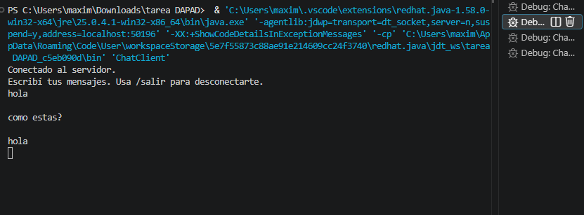
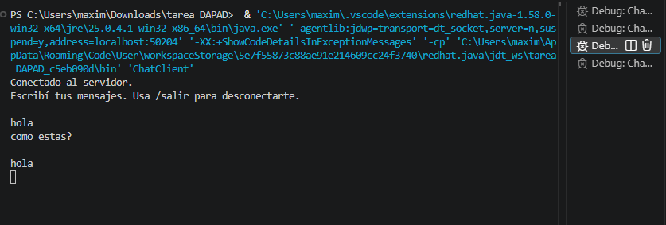
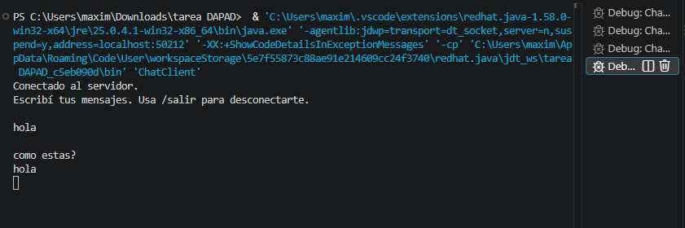
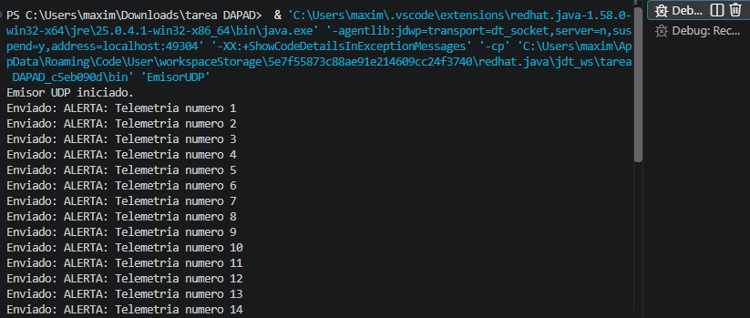
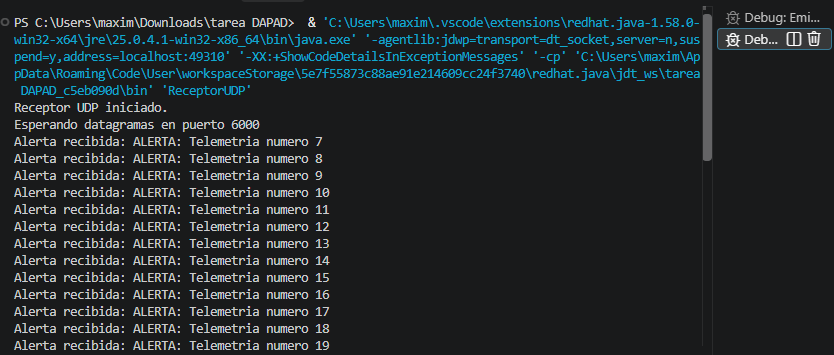
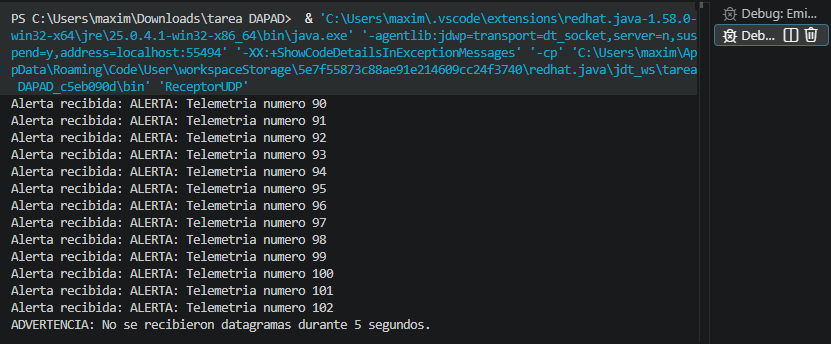

Trabajo Práctico N° 3

Desarrollo de Aplicaciones para Ambientes Distribuidos

Unidad 2: Comunicación entre Procesos y Concurrencia

1. Descripción del proyecto

El proyecto implementa dos modelos de comunicación utilizando la API java.net de Java.

- Ejercicio 1: Servidor de chat TCP multihilo.
- Ejercicio 2: Emisor y receptor UDP con control de timeout.

2. Cuestionario teórico

1. Diferencias entre TCP y UDP

TCP es un protocolo orientado a conexión. Antes de intercambiar información establece una conexión entre el cliente y el servidor. Garantiza la entrega ordenada de los datos y utiliza mecanismos de control de errores y retransmisión.

UDP es un protocolo sin conexión. Envía datagramas sin establecer previamente una conexión. No garantiza que los paquetes lleguen a destino ni que lo hagan en orden, pero tiene menor sobrecarga de comunicación.

2. Función de ServerSocket.accept()

El método accept() espera bloqueantemente hasta que un cliente solicita establecer una conexión con el servidor.

Cuando recibe una solicitud, devuelve un objeto Socket que permite comunicarse con ese cliente.

Es necesario utilizar un hilo independiente por cliente para permitir que varios usuarios sean atendidos simultáneamente, evitando que una comunicación bloquee la atención de las demás.

3. Pérdida de paquetes UDP y setSoTimeout()

Si un paquete UDP se pierde durante la transmisión, el receptor no recibe ninguna notificación automática de esa pérdida.

El método setSoTimeout(5000) establece un tiempo máximo de espera de cinco segundos para recibir un datagrama.

Si no llega ningún datagrama durante ese período, Java lanza SocketTimeoutException. El receptor captura la excepción, registra una advertencia y continúa escuchando.

Es importante aclarar que el timeout detecta la ausencia de recepción durante un intervalo, pero no identifica por sí solo qué paquete se perdió.

3. Requisitos

- Java JDK 21.
- Visual Studio Code.
- Extension Pack for Java.

4. Estructura del proyecto

TP3/
├── src/
│   ├── ChatServer.java
│   ├── ChatClient.java
│   ├── ReceptorUDP.java
│   └── EmisorUDP.java
├── capturas/
│   ├── servidor-tcp.png
│   ├── cliente-1.png
│   ├── cliente-2.png
│   ├── cliente-3.png
│   ├── emisor-udp.png
│   ├── receptor-udp.png
│   └── timeout-udp.png
└── README.md

5. Ejecución desde Visual Studio Code

Abrir la carpeta TP3 en Visual Studio Code y asegurarse de tener instalada la extensión Extension Pack for Java, luego ejecutar los archivos mediante la opciones Run luego Start Debugging.

6. Orden de ejecución

Chat TCP

1. Ejecutar "ChatServer.java" para iniciar el servidor.
2. Ejecutar "ChatClient.java" en tres terminales independientes para conectar los clientes.
3. Escribir mensajes desde cualquiera de los clientes para comprobar la comunicación.

Comunicación UDP

1. Ejecutar "ReceptorUDP.java" para iniciar la escucha.
2. Ejecutar "EmisorUDP.java" para comenzar a enviar alertas.
3. Para comprobar el timeout, detener el emisor y esperar cinco segundos sin recibir datagramas.

7. Evidencias

Se incluyen capturas de pantalla que demuestran:

1. Servidor TCP atendiendo tres clientes simultáneamente.

![Servidor TCP] (capturas/servidor-tcp.png)

2. Clientes TCP conectados.

Cliente 1:

Cliente 2:

Cliente 3:

3. Emisor y receptor UDP intercambiando alertas.

Emisor UDP:

Receptor UDP:

4. Funcionamiento del timeout UDP después de cinco segundos sin recibir datagramas.

