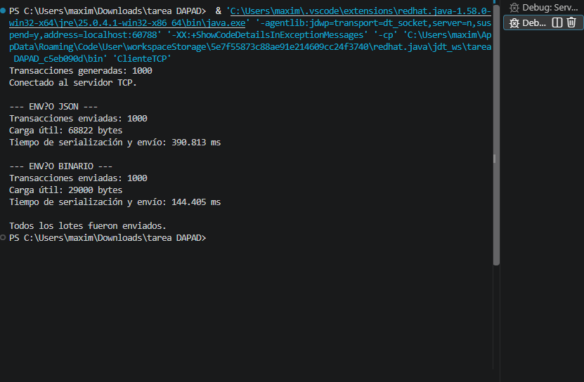
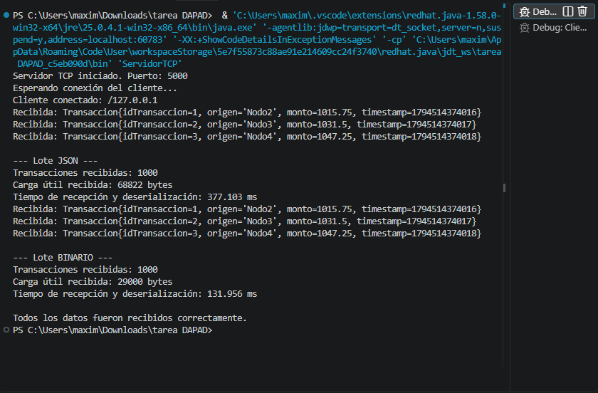

TP4 – Representación de Datos y Paso de Mensajes

1. Objetivo

El objetivo de este trabajo práctico es implementar un sistema de comunicación entre un cliente y un servidor TCP, utilizando dos formatos de representación de datos: JSON y binario.

Se busca comparar ambos formatos en cuanto al tamaño de los mensajes y el tiempo de serialización, envío, recepción y deserialización.

2. Estructura del proyecto

TP4/
├── src/
│   ├── Transaccion.java
│   ├── ParserMensajes.java
│   ├── ServidorTCP.java
│   └── ClienteTCP.java
├── capturas/
│   ├── cliente-tp4.png
│   └── servidor-tp4.png
└── README.md

3. Descripción de las clases

- Transaccion.java: define la estructura de una transacción con los atributos "idTransaccion", "origen", "monto" y "timestamp".
- ParserMensajes.java: implementa la serialización y deserialización de las transacciones en formato JSON y binario.
- ServidorTCP.java: recibe las transacciones mediante una conexión TCP, las deserializa y muestra los resultados.
- ClienteTCP.java: genera 1000 transacciones simuladas y las envía al servidor utilizando ambos formatos.

4. Funcionamiento

El cliente genera 1000 transacciones simuladas.

Primero las serializa en formato JSON y las envía al servidor. Luego realiza el mismo procedimiento utilizando el formato binario.

Para identificar los mensajes y permitir que el servidor sepa cuánto debe leer, se utiliza un protocolo que incluye:

- Un identificador del formato ("J" para JSON y "B" para binario).
- La cantidad de transacciones.
- La longitud de cada mensaje.
- Los bytes correspondientes al contenido.

El servidor recibe ambos lotes, deserializa las transacciones y muestra los resultados en consola.

5. Resultados de la ejecución

Se realizó una prueba con 1000 transacciones utilizando cada formato.

Comparación de resultados

Medición| JSON| Binario
Transacciones enviadas| 1000| 1000
Tamaño total del contenido| 68.822 bytes| 29.000 bytes
Tiempo de serialización y envío| 285,941 ms| 183,529 ms
Tiempo de recepción y deserialización| 278,851 ms| 173,247 ms

Análisis:

En esta ejecución, el formato binario ocupó 29.000 bytes, mientras que JSON ocupó 68.822 bytes.

Esto representa una reducción aproximada del 57,9 % en el tamaño del contenido enviado.

También se observaron menores tiempos de envío y recepción para el formato binario en esta prueba.

Los tiempos corresponden a una única ejecución y pueden variar según las condiciones del equipo y del sistema.

Nota: los tamaños indicados corresponden únicamente al contenido serializado de las transacciones. No incluyen los bytes adicionales utilizados por el protocolo para identificar los formatos, indicar la cantidad de registros y delimitar cada mensaje.

6. Cómo ejecutar el proyecto

Se necesita tener instalado el JDK de Java.

1. Abrir el proyecto en Visual Studio Code.
2. Ejecutar primero "ServidorTCP.java".
3. Ejecutar después "ClienteTCP.java".
4. Revisar los resultados en ambas consolas.

El servidor escucha en el puerto "5000" y el cliente se conecta a "localhost".

Una vez recibidos los dos lotes de transacciones, el servidor finaliza su ejecución.

7. Capturas de ejecución

Cliente TCP

Servidor TCP

