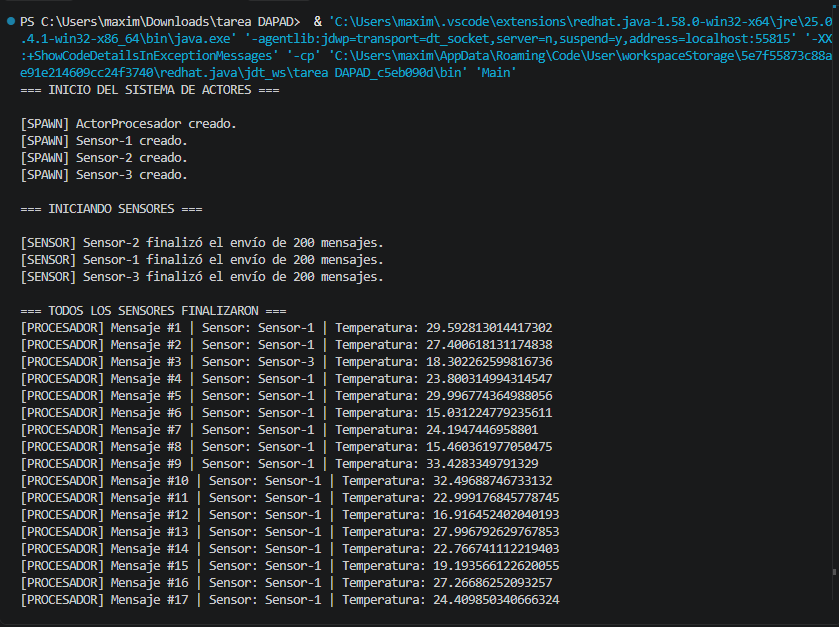
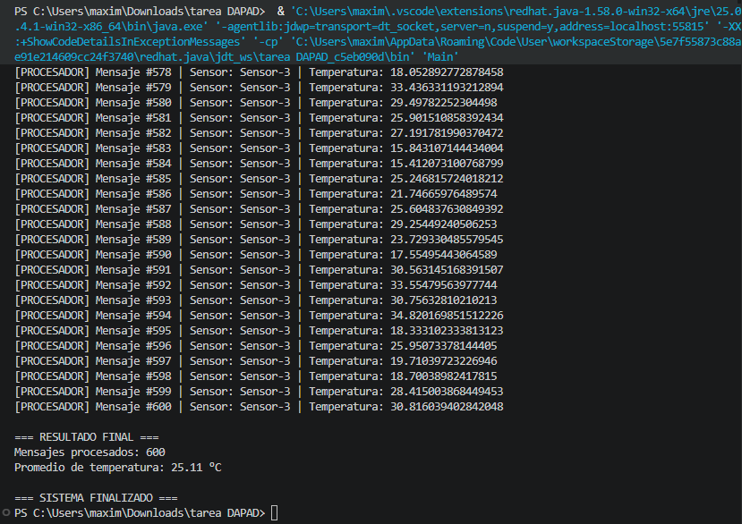
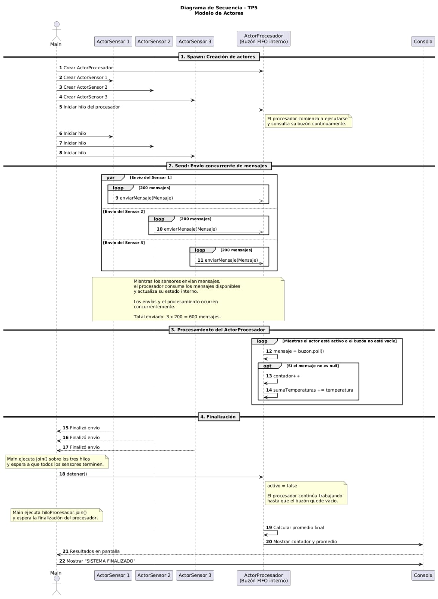

Trabajo Práctico N.º 5: Concurrencia y Sincronización con el Modelo de Actores

Cátedra: Desarrollo de Aplicaciones para Ambientes Distribuidos
Docente: Lic. Gabriel Artaza

1. Descripción del proyecto

El presente trabajo práctico consiste en implementar un sistema concurrente basado en el Modelo de Actores, utilizando Java.

El sistema está compuesto por actores sensores que generan lecturas de temperatura y las envían mediante mensajes inmutables a un actor procesador central.

El actor procesador recibe los mensajes a través de un buzón FIFO (First In, First Out), procesa las lecturas secuencialmente y mantiene un contador y un promedio acumulado de las temperaturas recibidas.

La implementación utiliza hilos ("Thread") para ejecutar los actores concurrentemente y una cola segura para gestionar la comunicación entre ellos, sin utilizar bloques "synchronized" ni primitivas "ReentrantLock".

2. Arquitectura del sistema

El sistema está compuesto por los siguientes elementos:

Mensaje

La clase "Mensaje" representa la información enviada por los sensores al procesador.

Cada mensaje contiene:

- Identificador del sensor que lo generó.
- Temperatura registrada.
- Fecha y hora de creación del mensaje.

Los atributos son privados y finales, por lo que la información del mensaje no puede modificarse después de su creación.

ActorSensor

La clase "ActorSensor" representa un dispositivo que genera mediciones de temperatura.

Cada sensor:

- Genera temperaturas aleatorias entre 15 °C y 35 °C.
- Crea objetos "Mensaje" con sus respectivas mediciones.
- Envía los mensajes al buzón del procesador.

Se utilizan tres sensores independientes, cada uno encargado de generar 200 mensajes.

ActorProcesador

La clase "ActorProcesador" representa el nodo central encargado de recibir y procesar las lecturas.

Sus responsabilidades son:

- Recibir mensajes mediante una cola "ConcurrentLinkedQueue".
- Extraer los mensajes del buzón utilizando el método "poll()".
- Procesar los mensajes secuencialmente.
- Mantener un contador de mensajes procesados.
- Acumular las temperaturas recibidas.
- Calcular el promedio final de las temperaturas.

El contador y la suma de temperaturas son atributos privados del procesador. Su actualización se realiza desde el hilo encargado de ejecutar este actor.

Main

La clase "Main" se encarga de iniciar y coordinar la ejecución del sistema.

Sus funciones principales son:

- Crear el actor procesador.
- Crear los tres actores sensores.
- Iniciar los hilos correspondientes.
- Esperar a que todos los sensores terminen de enviar sus mensajes.
- Indicar al procesador que finalice su ejecución.
- Esperar a que se complete el procesamiento de todos los mensajes.

3. Operaciones del Modelo de Actores

Spawn (Crear)

Se crean dinámicamente los actores necesarios para el funcionamiento del sistema: un actor procesador y tres actores sensores.

Cada actor se ejecuta mediante un hilo independiente.

Send (Enviar)

Los sensores generan y envían mensajes al procesador de manera asincrónica mediante el método "enviarMensaje()".

Cada sensor envía 200 mensajes, alcanzando un total de 600 mensajes concurrentes.

State Change (Cambio de estado)

Cada vez que el procesador recibe y atiende un mensaje, actualiza su estado interno.

Las actualizaciones consisten en incrementar el contador de mensajes procesados y acumular la temperatura recibida para calcular posteriormente el promedio histórico.

4. Concurrencia y sincronización

La implementación utiliza "ConcurrentLinkedQueue" como buzón de mensajes, permitiendo que varios sensores envíen información mientras el procesador consume los mensajes.

El procesamiento de las lecturas se realiza secuencialmente desde un único hilo, evitando que varios sensores modifiquen simultáneamente el contador y la suma de temperaturas.

No se utilizan bloques "synchronized" ni primitivas "ReentrantLock".

5. Resultados de la ejecución

El sistema fue configurado con tres sensores, cada uno encargado de generar 200 lecturas de temperatura.

Por lo tanto, se espera el procesamiento de un total de 600 mensajes.

Al finalizar, el procesador muestra la cantidad total de mensajes procesados y el promedio de las temperaturas recibidas.

En la ejecución realizada se obtuvo:

- Sensores utilizados: 3.
- Mensajes por sensor: 200.
- Total de mensajes procesados: 600.
- Promedio de temperatura: 25,11 °C.

6. Ejecución del proyecto

Para ejecutar el programa se necesita tener instalado el JDK de Java.

El proyecto puede abrirse desde Visual Studio Code y ejecutarse desde el archivo "Main.java".

Al iniciar la ejecución, se crean los actores, se generan los mensajes y el procesador comienza a consumirlos hasta completar el procesamiento.

7. Evidencias de ejecución

A continuación, se presentan dos capturas de pantalla correspondientes a la ejecución del sistema.

Debido a la extensión de la salida generada en consola (600 mensajes procesados), se seleccionaron dos fragmentos representativos de la misma ejecución.

7.1. Inicio de la ejecución

Se muestra la creación del actor procesador, la generación de los tres sensores y el inicio del envío de mensajes.

7.2. Finalización y resultados

Se muestra el procesamiento de los últimos mensajes, el contador final de 600 mensajes procesados, el promedio de temperatura y la finalización del sistema.

8. Diagrama de secuencia

El siguiente diagrama representa la creación de los actores, el envío concurrente de mensajes, su procesamiento y la finalización del sistema.

