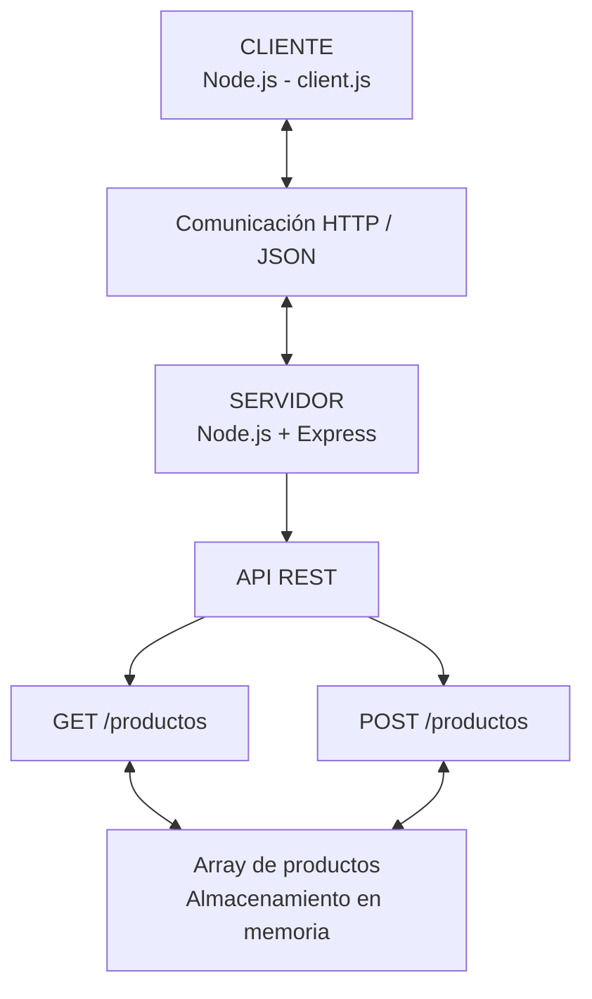
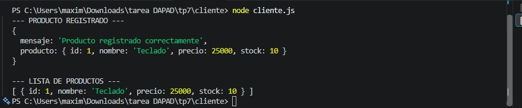
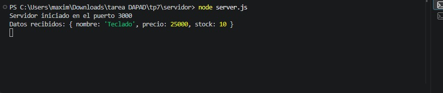
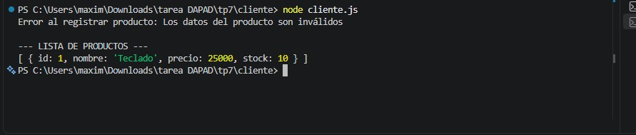

### Trabajo Práctico N.º 7
 Integración entre Capas y Consumo de APIs / Servicios Distribuidos

Estudiante: maximiliano nahuel martinez
Materia: Desarrollo de Aplicaciones para Ambientes Distribuidos  
Cátedra: Lic. Gabriel Artaza  
Lenguaje: JavaScript  
Tecnologías: Node.js y Express  
Modelo de comunicación: API REST mediante HTTP/JSON

---

 1. Descripción del proyecto

El objetivo de este trabajo práctico es desarrollar un servicio distribuido que permita la comunicación entre un cliente independiente y un servidor mediante una API REST.

Para ello, se implementó un pequeño sistema de gestión de inventario que permite consultar y registrar productos.

La aplicación está dividida en dos componentes:

- Servidor: desarrollado con Node.js y Express. Expone los endpoints de la API REST, procesa las solicitudes y devuelve respuestas en formato JSON.
- Cliente: desarrollado con JavaScript y Node.js. Realiza solicitudes HTTP al servidor, envía datos estructurados y procesa las respuestas recibidas.

Los productos se almacenan temporalmente en memoria mediante un array de JavaScript.

 2. Arquitectura del sistema

El sistema utiliza una arquitectura cliente-servidor. Ambos componentes funcionan como procesos independientes y se comunican mediante el protocolo HTTP, intercambiando información en formato JSON.

 Diagrama de arquitectura


Formato de datos

Ejemplo de los datos enviados por el cliente mediante POST:

```json
{
  "nombre": "Teclado",
  "precio": 25000,
  "stock": 10
}
```

El servidor interpreta el contenido JSON, procesa los datos y devuelve una respuesta con el resultado de la operación.

 3. Manejo de errores

Se implementaron mecanismos de validación y tratamiento de errores tanto en el servidor como en el cliente.

Los principales códigos HTTP contemplados son:

Código| Descripción
200   | Solicitud procesada correctamente.
201   | Producto registrado correctamente.
400   | Datos inválidos o JSON mal formado.
404   | Ruta solicitada inexistente.
500   | Error interno del servidor.

El cliente utiliza bloques "try/catch" para capturar excepciones y comprobar los códigos de respuesta HTTP.

 4. Evidencias de ejecución

A continuación se incorporan las capturas que demuestran el funcionamiento del sistema.

Captura 1: Invocación exitosa

Demostración de las solicitudes realizadas por el cliente y las respuestas correctas del servidor.



Captura 2: Estructura de datos

Demostración de la carga útil (payload) JSON recibida por el servidor.



Captura 3: Manejo de errores

Demostración del comportamiento del sistema ante una solicitud inválida o un fallo simulado.



 5. Instrucciones de ejecución

Requisitos previos

- Node.js instalado.
- npm (incluido con Node.js).

Instalación de dependencias

Desde la carpeta del servidor, ejecutar:

npm install

Ejecución del servidor

Desde la carpeta "TP7/servidor", ejecutar:

node server.js

El servidor quedará escuchando solicitudes HTTP en el puerto 3000.

Ejecución del cliente

Abrir una segunda terminal y, desde la carpeta "TP7/cliente", ejecutar:

node cliente.js

El cliente realizará automáticamente las siguientes operaciones:

1. Enviará una solicitud POST para registrar un producto.
2. Recibirá la respuesta del servidor.
3. Enviará una solicitud GET para consultar los productos.
4. Mostrará los resultados en la consola.

Importante: los productos se almacenan en memoria, por lo que se pierden al reiniciar el servidor.