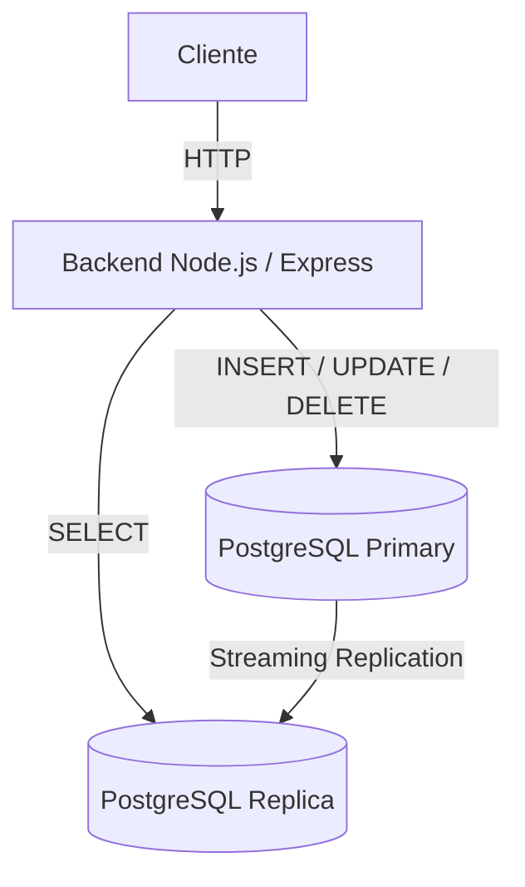
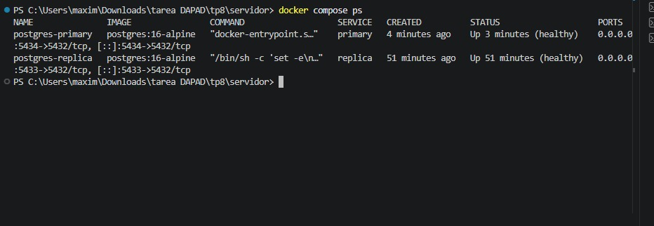
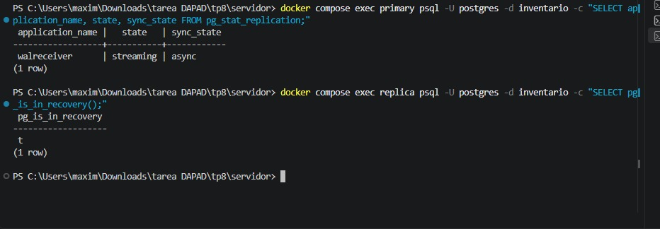
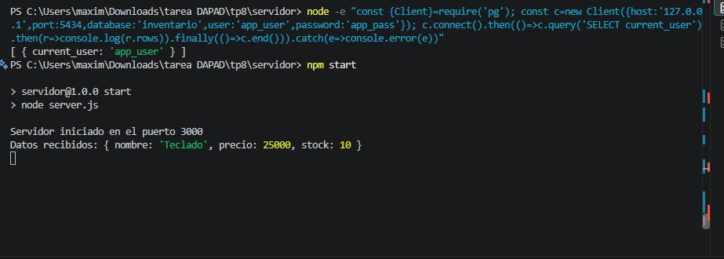
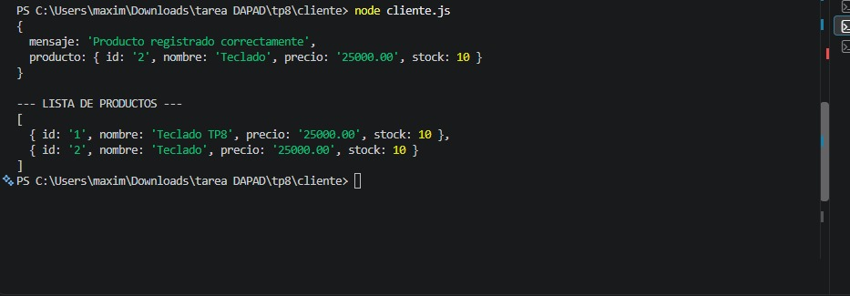
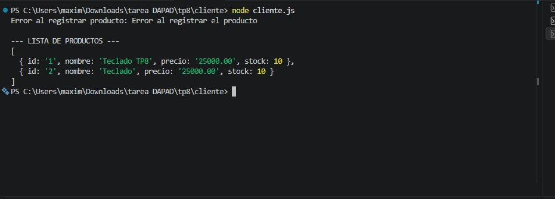

### TP8 – Bases de Datos Distribuidas y Conexión entre Capas

 1. Introducción

El objetivo de este trabajo práctico es implementar una arquitectura de base de datos distribuida, conectar una aplicación backend con sus nodos y comprobar el comportamiento del sistema ante operaciones de lectura, escritura y fallos.

Para este trabajo se implementó una arquitectura de replicación Primary-Replica (Primario-Réplica) utilizando PostgreSQL, Docker y Node.js con Express.

El sistema separa las operaciones de escritura y lectura:
- Las operaciones de escritura se realizan sobre el nodo primario.
- Las operaciones de lectura se realizan sobre el nodo réplica.

 2. Tecnologías utilizadas

- Node.js: entorno de ejecución del backend.
- Express: framework para crear la API REST.
- PostgreSQL 16: sistema gestor de bases de datos.
- Docker y Docker Compose: creación y administración de los contenedores.
- pg: driver de PostgreSQL para Node.js.
- JavaScript: lenguaje utilizado para desarrollar el backend.

 3. Arquitectura del sistema

Se implementó una arquitectura con dos nodos PostgreSQL:

- Primary: nodo principal que recibe las operaciones de escritura.
- Replica: nodo secundario que recibe los cambios del primario mediante replicación y atiende las consultas de lectura.

La replicación utilizada es física mediante streaming replication, configurada en modo asíncrono.

Diagrama de arquitectura



El backend utiliza dos conexiones independientes mediante el driver pg: una para el nodo primario y otra para la réplica.

Puertos utilizados

| Servicio | Puerto del contenedor | Puerto del equipo |
|---|---:|---:|
| PostgreSQL Primary | 5432 | 5434 |
| PostgreSQL Replica | 5432 | 5433 |
| Backend Express | — | 3000 |

El puerto externo del primario se configuró en 5434 para evitar conflictos con una instalación local de PostgreSQL.

4. Estructura del proyecto

```text
tp8/
│
├── cliente/
│   └── cliente.js
│
├── database/
│   ├── init/
│   │   └── 01-init.sql
│   └── primary/
│       └── pg_hba.conf
│
├── evidencia/
│   ├── 01-contenedores.jpeg
│   ├── 02-replicacion.jpeg
│   ├── 03-servidor-conexion.jpeg
│   ├── 04-registro-y-consulta.jpeg
│   └── 05-caida-primario.jpeg
│
├── servidor/
│   ├── server.js
│   ├── package.json
│   └── package-lock.json
│
├── docker-compose.yml
└── readme.md
```

5. Configuración de la base de datos

Se utilizó Docker Compose para levantar los dos nodos PostgreSQL.

El nodo primario se configura para permitir la replicación, mientras que el nodo réplica obtiene una copia inicial de los datos mediante pg_basebackup y luego recibe los cambios del primario mediante streaming replication.

Se crearon tres usuarios:

- postgres: usuario administrador de PostgreSQL.
- app_user: usuario utilizado por el backend para acceder a la base de datos.
- replicator: usuario destinado a la conexión de replicación.

La base de datos utilizada se llama inventario y contiene la tabla productos, con los siguientes campos:

| Campo | Tipo | Descripción |
|---|---|---|
| id | BIGSERIAL | Identificador del producto |
| nombre | VARCHAR(100) | Nombre del producto |
| precio | NUMERIC(10,2) | Precio del producto |
| stock | INTEGER | Cantidad disponible |

6. Funcionamiento del backend

El backend está desarrollado con Node.js y Express. Se conecta a PostgreSQL mediante el paquete `pg`.

Se implementaron dos conexiones:

- dbPrimary: conexión destinada a las operaciones de escritura.
- dbReplica: conexión destinada a las operaciones de lectura.

Rutas implementadas

GET /productos

Consulta todos los productos almacenados utilizando el nodo réplica.

POST /productos

Registra un producto nuevo utilizando el nodo primario. Antes de insertar los datos, el backend valida que el nombre, el precio y el stock sean correctos.

La inserción utiliza parámetros SQL para evitar concatenar directamente los valores recibidos en la consulta.

 7. Pruebas realizadas

 7.1. Verificación del cluster

Se levantaron los contenedores correspondientes al nodo primario y al nodo réplica mediante Docker Compose.

Se comprobó que ambos contenedores estuvieran funcionando correctamente.



 7.2. Verificación de la replicación

Se verificó que el nodo primario tuviera una conexión de replicación activa y que su estado fuera streaming.

También se consultó la función pg_is_in_recovery() en el nodo réplica, obteniendo el resultado true, lo que confirma que se encuentra funcionando como réplica en recuperación.



 7.3. Conexión del backend

Se inició el servidor Node.js y se comprobó que pudiera establecer conexión con la infraestructura PostgreSQL.



 7.4. Prueba de escritura y lectura

Se ejecutó el cliente para registrar un producto mediante la ruta POST /productos.

El backend realizó la inserción en el nodo primario y posteriormente se consultó la lista de productos mediante GET /productos, cuya consulta se dirige al nodo réplica.

La operación de registro devolvió el código HTTP 201 (Created), mientras que la consulta devolvió el código HTTP 200 (OK).

De esta manera se comprobó que los datos insertados en el primario podían consultarse desde la réplica.



 7.5. Simulación de caída del nodo primario

Para evaluar el comportamiento del sistema ante un fallo, se detuvo el contenedor correspondiente al nodo primario.

Luego se volvió a ejecutar el cliente.

Se observó que:
- La operación POST no pudo realizarse porque el nodo primario estaba detenido.
- La operación GET continuó funcionando, ya que el nodo réplica permanecía disponible y podía responder las consultas.

Esto demuestra que la separación de conexiones permite mantener las operaciones de lectura disponibles ante la caída del primario, aunque las operaciones de escritura quedan interrumpidas.

Importante: la implementación no realiza una promoción automática de la réplica a primario. Por lo tanto, ante la caída del nodo principal, las escrituras no se redirigen automáticamente.

