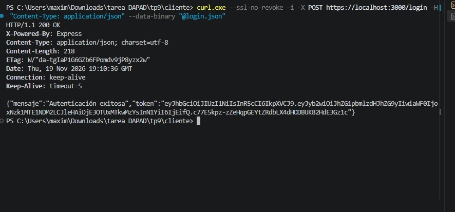
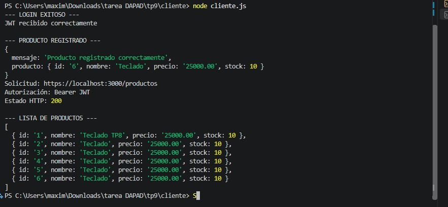
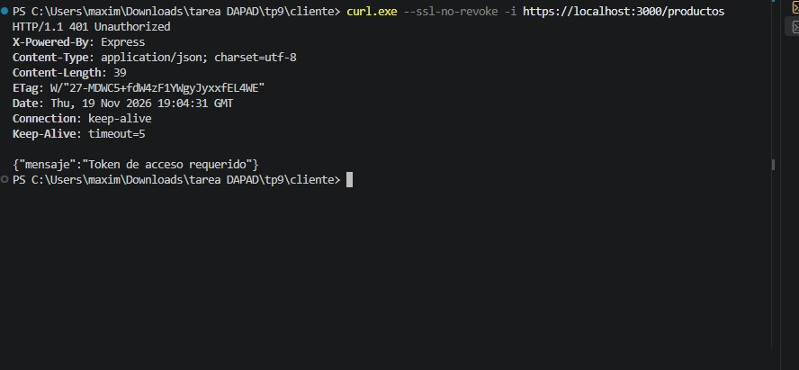

Trabajo Práctico N.º 9: Seguridad en Aplicaciones Distribuidas (JWT y TLS/SSL)

1. Identificación

Estudiante: Maximiliano nahuel martinez 
Asignatura: Desarrollo de Aplicaciones para Ambientes Distribuidos
Unidad temática: Unidad 4 — Seguridad en Aplicaciones Distribuidas

Tecnologías y herramientas utilizadas

- Node.js: entorno de ejecución de JavaScript.
- Express: framework para implementar el servidor y las rutas HTTP.
- jsonwebtoken: generación y validación de tokens JWT.
- HTTPS / TLS: cifrado de las comunicaciones.
- mkcert: generación de certificados locales de desarrollo.
- PostgreSQL: almacenamiento de los productos.
- Docker: ejecución de los servicios de base de datos.
- PowerShell: ejecución de comandos y pruebas.
- Git y GitHub: control de versiones y entrega del proyecto.

2. Descripción del proyecto

El objetivo de este trabajo es incorporar una capa de seguridad a una aplicación distribuida mediante dos mecanismos principales:

- TLS/HTTPS: protege la comunicación entre cliente y servidor mediante cifrado en tránsito.
- JWT: permite autenticar usuarios y controlar el acceso a los endpoints protegidos sin mantener sesiones en el servidor.

El servidor ofrece un endpoint de autenticación y dos operaciones para consultar y registrar productos, aplicando permisos según el rol del usuario.

3. Estructura del proyecto

TP8/
│
├── servidor/
│   ├── server.js
│   ├── package.json
│   └── package-lock.json
│
├── cliente/
│   ├── cliente.js
│   └── login.json
│
├── database/
│   ├── init/
│   └── primary/
│
├── evidencia/
│   ├── 01-login-jwt.jpg
│   ├── 02-acceso-autorizado.jpg
│   ├── 03-acceso-sin-token.jpg
│   ├── 04-tampering.jpg
│   └── 05-control-roles.jpg
│
├── docker-compose.yml
└── README.md

4. Implementación de seguridad

4.1. Configuración TLS/HTTPS

Se utilizó mkcert para generar un certificado local de desarrollo.

El servidor utiliza el módulo "https" de Node.js para iniciar el servicio mediante HTTPS en el puerto 3000.

Los archivos del certificado y su clave privada se cargan desde la carpeta "servidor/certs/".

4.2. Autenticación mediante JWT

Se implementó el endpoint:

"POST /login"

El usuario envía sus credenciales y, si son correctas, el servidor devuelve un JWT firmado.

El token contiene los siguientes claims:

- "sub": identificador del usuario.
- "rol": rol asignado al usuario.
- "exp": fecha de expiración del token.

La validez del token está configurada en una hora.

4.3. Middleware de autenticación y autorización

Se implementaron dos middlewares:

- "autenticarToken": comprueba la presencia del token, verifica su firma y controla su expiración.
- "autorizarRol": comprueba si el usuario tiene el rol requerido para realizar una operación.

Comportamiento de las respuestas:

Situación| Código HTTP
Token ausente, inválido o expirado| 401
Usuario sin permisos suficientes| 403
Operación autorizada correctamente| 200

El endpoint GET "/productos" requiere autenticación.

El endpoint POST "/productos" requiere autenticación y el rol "administrador".

4.4. Prueba de Tampering

Se realizó una prueba de alteración del payload de un JWT sin volver a firmarlo.

Se modificó el rol contenido en el payload y se envió el token alterado al servidor.

El servidor rechazó la solicitud porque la firma dejó de ser válida, devolviendo HTTP 401.

5. Instrucciones de instalación y ejecución

5.1. Requisitos previos

- Node.js instalado.
- npm instalado.
- Docker Desktop instalado y funcionando.
- mkcert instalado.
- PostgreSQL disponible mediante los servicios configurados para el proyecto.

5.2. Instalar las dependencias

Abrir una terminal en la carpeta "servidor" y ejecutar:

npm install

5.3. Generar los certificados TLS

Instalar mkcert si todavía no está instalado:

winget install FiloSottile.mkcert

Desde la carpeta "servidor", instalar la autoridad certificadora local:

mkcert -install

Crear la carpeta de certificados:

New-Item -ItemType Directory -Force certs

Generar el certificado y la clave privada:

mkcert -cert-file certs/localhost+2.pem -key-file certs/localhost+2-key.pem localhost 127.0.0.1 ::1

Estos archivos deben estar disponibles para que el servidor pueda iniciar HTTPS.

5.4. Iniciar la base de datos

Asegurarse de que los servicios PostgreSQL estén funcionando y que la base de datos "inventario" esté disponible.

El servidor utiliza las siguientes conexiones:

- Nodo primario: puerto "5434".
- Nodo secundario: puerto "5433".

Si los contenedores todavía no están iniciados, ejecutar desde la carpeta raíz del proyecto:

docker compose up -d

Si los contenedores ya están funcionando por el TP8, no es necesario iniciarlos nuevamente.

5.5. Iniciar el servidor HTTPS

Abrir una terminal en la carpeta "servidor".

Configurar la clave secreta utilizada para firmar los JWT:

$env:JWT_SECRET="clave_secreta_tp9_2026"

Iniciar el servidor:

node server.js

El servidor estará disponible en:

"https://localhost:3000"

5.6. Ejecutar el cliente

Abrir otra terminal en la carpeta "cliente".

Configurar la autoridad certificadora local para que Node.js pueda validar el certificado del servidor:

$env:NODE_EXTRA_CA_CERTS="$(mkcert -CAROOT)\rootCA.pem"

Ejecutar el cliente:

node cliente.js

El cliente inicia sesión, recibe el JWT y utiliza el token para realizar las solicitudes protegidas.

Importante: las variables de entorno deben configurarse en la terminal correspondiente antes de ejecutar cada proceso. Si se abre otra terminal, será necesario configurarlas nuevamente.

6. Capturas de evidencia

Las siguientes capturas demuestran el funcionamiento de los mecanismos de seguridad implementados.

Captura 1 — Emisión de JWT

Petición exitosa al endpoint "/login", con respuesta HTTP 200 y recepción del token JWT en formato JSON.

Captura 2 — Acceso autorizado por HTTPS

Consulta de productos mediante HTTPS, enviando el JWT en el encabezado "Authorization: Bearer". El servidor responde correctamente con HTTP 200.

Captura 3 — Rechazo por falta de token

Solicitud a un recurso protegido sin enviar credenciales válidas. El servidor rechaza la petición y devuelve HTTP 401 Unauthorized.

Captura 4 — Detección de Tampering

Solicitud realizada con un JWT cuyo payload fue alterado sin volver a firmar. El servidor detecta la firma inválida y rechaza la petición con HTTP 401.

